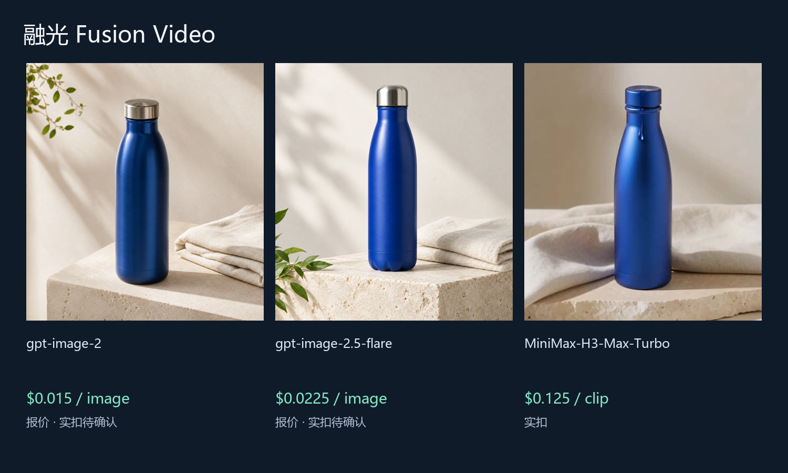
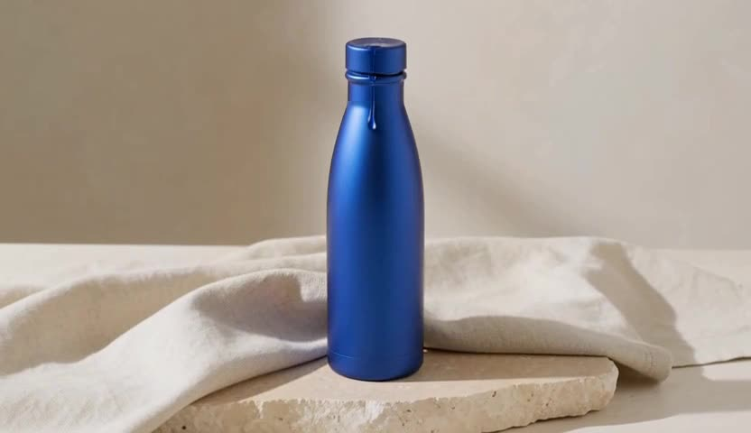

# 更低成本的 融光 Fusion Video 图片与视频方案

[English](README.md) | 中文

用图片和视频素材做创作项目.

完成独立 API 图片与视频素材生成。Java 图片策略的同步返回和视频策略的状态解析需新增适配；未编译或部署原应用，未完成原生视频任务回写。

Upstream: [Stonewuu/ai-fusion-video](https://github.com/Stonewuu/ai-fusion-video) · fixed SHA `a71143ede8c9f0a570a93e76dc8ed6dac4df3de8` · MIT. Community work by ToAPIs; no upstream endorsement or partnership is implied. Existing sponsors and referral links are unchanged. “Lower-cost” describes the priced ToAPIs route, not a measured savings claim against every upstream supplier.

## 演示



### gpt-image-2 — $0.015 报价，实扣待确认


```json
{
  "model": "gpt-image-2",
  "n": 1,
  "size": "1:1",
  "resolution": "1K",
  "metadata": {
    "resolution": "1K"
  }
}
```

### gpt-image-2.5-flare — $0.0225 报价，实扣待确认


```json
{
  "model": "gpt-image-2.5-flare",
  "n": 1,
  "size": "1:1",
  "metadata": {
    "resolution": "1K"
  },
  "quality": "high"
}
```

### MiniMax-H3-Max-Turbo — $0.125 实扣

[](assets/MiniMax-H3-Max-Turbo-767400ee90.mp4)

[MP4 — 5.18s](assets/MiniMax-H3-Max-Turbo-767400ee90.mp4)

```json
{
  "model": "MiniMax-H3-Max-Turbo",
  "duration": 5,
  "resolution": "480P",
  "aspect_ratio": "16:9"
}
```

## API pricing

| Model / 模型 | Preset / 参数 | API pricing | Case / 本次案例 |
|---|---|---|---|
| gpt-image-2 | n=1, size=1:1, resolution=1K, metadata={'resolution': '1K'} | $0.015/image | $0.015 quote |
| gpt-image-2.5-flare | n=1, size=1:1, metadata={'resolution': '1K'}, quality=high | $0.0225/image | $0.0225 quote |
| MiniMax-H3-Max-Turbo | duration=5, resolution=480P, aspect_ratio=16:9 | $0.025/s | $0.125 actual; 5.18s; $0.024131/s observed |

Token-metered rates use actual tokens; the observed $/s is this case’s settled cost divided by decoded MP4 duration, not a fixed future rate. Quotes are same-Key prices dated 2026-10-22, not confirmed charges. The client rechecks pricing before a paid submission.

## Run / 运行

No dependencies for the standalone client. Set `TOAPIS_API_KEY` privately. Base URL is `https://toapis.com` (without `/v1`); the client adds `/v1`.

```sh
python unified_client.py --model gpt-image-2 --prompt-file prompts/image.txt --max-usd .10
# quote only; explicitly add --live to submit a paid job
python unified_client.py --model gpt-image-2 --prompt-file prompts/image.txt --max-usd .10 --live --run-id my-reviewed-case
```

Same request + same run ID resumes the existing task. If a POST response is uncertain and has no ID, stop and reconcile; do not issue a replacement POST. Polling: `GET /v1/images/generations/{id}` or `/v1/videos/generations/{id}`; result: `result.data[0].url`; Bearer auth applies only to the API, not result downloads. Read settled `billing.cost_usd` and `billing.credits`; missing final billing stays unknown. Public case records exclude task IDs, credentials and account data.

[Integration details / 接入边界](integration/README.md) · [Original image prompt](prompts/image.txt) · [Video prompt](prompts/video.txt) · [Sanitized cases](cases.json)

[Model pricing & signup / 模型价表及注册](https://go.toapis.com/1022_fg) · Campaign: `1022_fg`
